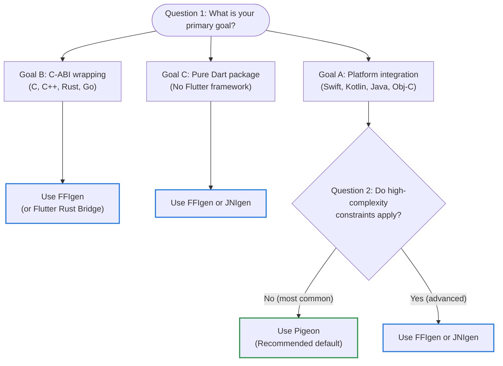

Flutter apps run on multiple platforms,
but sometimes you need to communicate directly
with the host operating system or run code from an existing native library.

To solve this, Flutter provides several interop tools ranging from
code generators to direct FFI bindings.

Use the following decision tree to choose your interop solution,
or read on to learn about the native interop layers.

## Choose your interop solution

---

Answer the following questions to walk through the decision tree in detail:

### Question 1: What is your primary goal?

**Goal A: Platform integration**
: Communicate with native OS features (Swift, Kotlin, Java, or Objective-C)
  or expose an API surface.
  Proceed to [Question 2: Do high-complexity constraints apply?](#question-2-do-high-complexity-constraints-apply).

**Goal B: C-ABI wrapping**
: Wrap an existing native library (C, C++, Rust, or Go).
  Use [FFIgen](/interop/ffigen)
  (or [Flutter Rust Bridge][frb] for Rust).

**Goal C: Pure Dart package**
: Build a Dart CLI tool without Flutter framework dependencies.
  Use [FFIgen](/interop/ffigen) or
  [JNIgen](/interop/jnigen).

### Question 2: Do high-complexity constraints apply?

If you're building a Flutter plugin,
first verify whether [Pigeon](/interop/pigeon) satisfies
your technical constraints.

:::important
Migrating a plugin between Pigeon and FFIgen or JNIgen is non-trivial
because the glue code lives in different languages.
Evaluate your plugin's constraints carefully before choosing between them.
:::

Do any of the following requirements apply to your feature?

- Your app processes high-frequency raw data (for example, video processing).
- Your integration requires advanced language bridging
  (for example, cross-language subclasses, delegates, or proxies).
- Your feature requires manual memory management and multithreading over
  guardrails.
- Your target language is C, C++, Rust, or Go.

Based on whether any of the preceding requirements apply,
choose your interop tool:

**No (most common) — Use [Pigeon](/interop/pigeon)**
: This is the default, recommended path.
  It provides necessary guardrails, creates easily digestible interface
  mappings, and is highly efficient for most API surface areas.

**Yes — Use [FFIgen](/interop/ffigen) or [JNIgen](/interop/jnigen)**
: You need the flexibility, complexity, and performance of direct interop for
  larger surface areas.

:::note
Directly using FFIgen and JNIgen introduces potential pitfalls,
particularly around threading and memory management.
Pigeon is generally recommended because it has fewer potential pitfalls
and provides safer guardrails.
:::

## Package your interop code

Depending on how you plan to share your code,
choose the option that best suits your use case.
To learn about the difference between a [package](/resources/glossary#package)
and a [plugin](/resources/glossary#plugin),
refer to the [Flutter glossary](/resources/glossary).

- **In-app integration.**
  Write your native interop code directly inside your Flutter app without
  creating a separate package.
- **Plugin.**
  A specialized package that makes native platform functionality (such as a
  device's camera or sensors) available to your app
  (`flutter create --template=plugin`).
  For more details, refer to
  [Developing plugin packages](/packages-and-plugins/developing-packages#plugin).
- **FFI package.**
  A package that compiles and bundles native C or C++ code (or pre-compiled
  binaries) using [Dart build hooks](/interop/bind-native-code) and
  [`dart:ffi`](/interop/dart-ffi).
  This template also includes an FFIgen configuration to regenerate
  Dart bindings (`flutter create --template=package_ffi`).
  For more details, refer to
  [Developing FFI packages](/packages-and-plugins/developing-packages#ffi).

For more details on package authoring,
refer to [Developing packages and plugins](/packages-and-plugins/developing-packages).

## Tool comparison

The following table compares two interop solutions:

- **Direct interop:** Lower-level direct bindings with higher performance for
  large data; requires manual memory and threading management.
- **Pigeon:** Structured, type-safe code generator; recommended default for
  Flutter plugins.

| Target language | Direct interop | Pigeon |
| --- | --- | --- |
| **C** | [FFIgen](/interop/ffigen) | Supported on Linux (GObject) with platform channels |
| **C++ with `extern "C"`** | [FFIgen](/interop/ffigen) | Supported on Windows with platform channels |
| **C++ without `extern "C"`** | FFIgen (not yet supported) | Supported on Windows with platform channels |
| **Rust with `extern "C"`** | [FFIgen](/interop/ffigen) | Not supported directly |
| **Rust without `extern "C"`** | [Flutter Rust Bridge][frb] | Not supported |
| **Go with `extern "C"`** | [FFIgen](/interop/ffigen) | Not supported directly |
| **Go without `extern "C"`** | Not supported | Not supported |
| **Java** | [JNIgen](/interop/jnigen) | Supported through Kotlin (native interop) or directly with platform channels |
| **Kotlin** | [JNIgen](/interop/jnigen) | Supported (recommended) |
| **Objective-C** | [FFIgen](/interop/ffigen) | Supported through Swift (native interop) or directly with platform channels |
| **Swift without Obj-C compatibility annotations** | [`package:swiftgen`][swiftgen-pub] (experimental) | Supported (recommended) |

{:.table .table-striped}

## Understand interop layers

Dart structures native interop into three distinct layers:
low-level bindings, idiomatic Dart APIs, and framework-specific plugins.

For complete architectural details,
consult the [native interop layers guide][interop-layers].

### Layer 1: Low-level bindings

Layer 1 consists of thin, high-performance, and unopinionated wrappers around
native code (for example, [`dart:ffi`](/interop/dart-ffi),
`dart:js_interop`, [FFIgen](/interop/ffigen),
and [JNIgen](/interop/jnigen)).
These APIs mirror native signatures closely,
but require manual memory and threading management.

### Layer 2: Idiomatic Dart APIs

Layer 2 consists of idiomatic Dart APIs that wrap the low-level layer to hide
platform-specific complexities (for example,
[Pigeon](/interop/pigeon) or the
[`sqlite3` package][sqlite3-pub]).
These manage concurrency, memory lifetimes, and data conversions automatically.

### Layer 3: Framework-specific plugins

Layer 3 provides integration with framework-specific APIs (for example, the
Flutter Plugin API).
This layer exposes Dart APIs to the framework while hiding platform details
like Android's `Context` or iOS's application lifecycle.

[frb]: {{site.pub-pkg}}/flutter_rust_bridge
[swiftgen-pub]: {{site.pub-pkg}}/swiftgen
[sqlite3-pub]: {{site.pub-pkg}}/sqlite3
[interop-layers]: https://github.com/dart-lang/native/blob/main/doc/interop-layers.md
