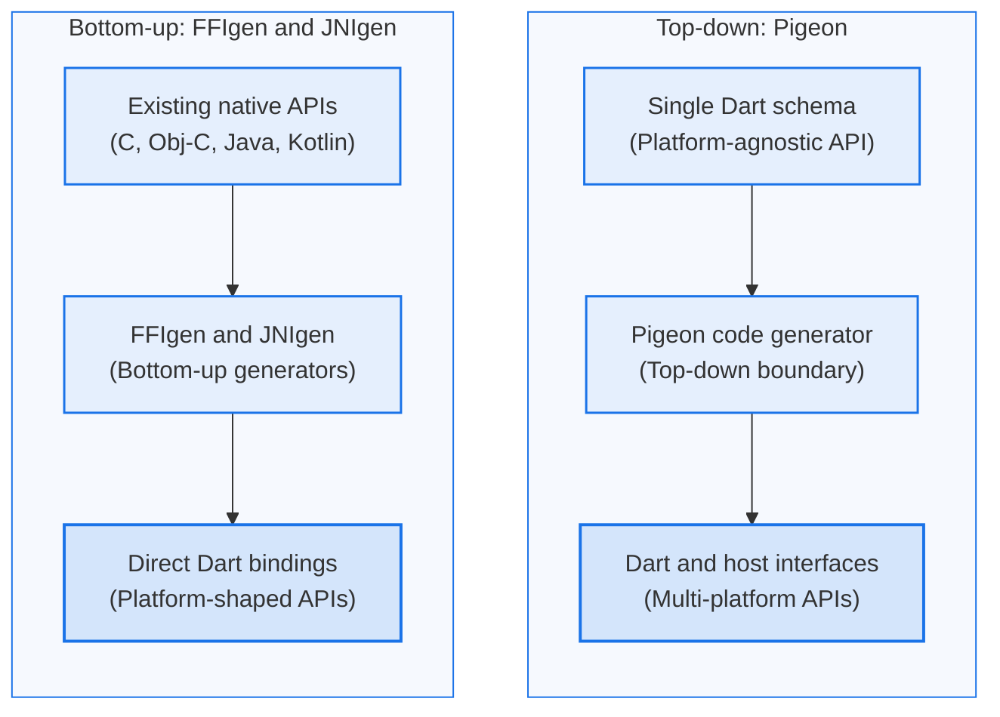

Flutter apps run on multiple platforms,
but sometimes you need to communicate directly
with the host operating system or run code from an existing native library.

To solve this, Flutter provides several interop tools ranging from
code generators to direct FFI bindings.

## Overview of interop tools

Flutter's interop tools take one of two architectural approaches
to bridging Dart and native code.
FFIgen and JNIgen use a bottom-up approach, which starts from existing
native APIs and generates Dart bindings that mirror them directly.
Pigeon uses a top-down approach, which starts from a single Dart schema
and generates matching client and host interfaces across multiple platforms.
Choose the approach that best fits your integration needs.

### Bottom-up with FFIgen and JNIgen

FFIgen and JNIgen generate low-level Dart bindings directly from your
target platform's headers or classes.
Because the generated bindings call native code without serialization
overhead, you're responsible for managing native memory lifetimes and
threading in your Dart code.

- [FFIgen](/interop/ffigen) parses C and Objective-C headers
  (including `@objc`-annotated Swift) to generate direct
  [`dart:ffi`](/interop/dart-ffi) bindings.
  Wrapping an iOS or macOS framework with FFIgen produces an
  Apple-shaped Dart API; wrapping a C library or C-ABI binary
  (C, C++ with `extern "C"`, Rust, or Go) produces a C-shaped Dart API.
- [JNIgen](/interop/jnigen) inspects Java and Kotlin classes,
  JAR and AAR files, or Android SDK packages to generate direct JNI bindings.
  Wrapping an Android package with JNIgen produces an
  Android-shaped Dart API.

### Top-down with Pigeon

[Pigeon](/interop/pigeon) starts from a single Dart schema that
defines an intentional, platform-agnostic boundary contract once and
enforces identical types and signatures across Android, iOS, macOS,
Windows, and Linux.
You implement the generated host interface on each target platform
while Pigeon handles type safety, data conversion, and cross-runtime
memory safety across the boundary.

Pigeon generates bindings over
[platform channels](/platform-integration/platform-channels)
for all supported platforms, and offers a preview option to generate
direct native interop bindings using [FFIgen](/interop/ffigen)
on iOS and macOS and [JNIgen](/interop/jnigen) on Android.

## Package your interop code

Depending on how you plan to share your code,
choose the option that best suits your use case.
To learn about the difference between a [package](/resources/glossary#package)
and a [plugin](/resources/glossary#plugin),
refer to the [Flutter glossary](/resources/glossary).

- **In-app integration.**
  Write your native interop code directly inside your Flutter app without
  creating a separate package.
- **Plugin.**
  A specialized package that makes native platform functionality (such as a
  device's camera or sensors) available to your app
  (`flutter create --template=plugin`).
  For more details, refer to
  [Developing plugin packages](/packages-and-plugins/developing-packages#plugin).
- **FFI package.**
  A package that compiles and bundles native C or C++ code (or pre-compiled
  binaries) using [Dart build hooks](/interop/bind-native-code) and
  [`dart:ffi`](/interop/dart-ffi).
  This template also includes an FFIgen configuration to regenerate
  Dart bindings (`flutter create --template=package_ffi`).
  For more details, refer to
  [Developing FFI packages](/packages-and-plugins/developing-packages#ffi).

For more details on package authoring,
refer to [Developing packages and plugins](/packages-and-plugins/developing-packages).

## Tool comparison

The following table compares two interop solutions:

- **Direct interop:** Lower-level direct bindings with higher performance for
  large data; requires manual memory and threading management.
- **Pigeon:** Structured, type-safe code generator for cross-platform
  boundary contracts.

| Target language | Direct interop | Pigeon |
| --- | --- | --- |
| **C** | [FFIgen](/interop/ffigen) | Supported on Linux (GObject) with platform channels |
| **C++ with `extern "C"`** | [FFIgen](/interop/ffigen) | Supported on Windows with platform channels |
| **C++ without `extern "C"`** | FFIgen (not yet supported) | Supported on Windows with platform channels |
| **Rust with `extern "C"`** | [FFIgen](/interop/ffigen) | Not supported directly |
| **Rust without `extern "C"`** | [Flutter Rust Bridge][frb] | Not supported |
| **Go with `extern "C"`** | [FFIgen](/interop/ffigen) | Not supported directly |
| **Go without `extern "C"`** | Not supported | Not supported |
| **Java** | [JNIgen](/interop/jnigen) | Supported with platform channels, or through Kotlin with native interop (preview) |
| **Kotlin** | [JNIgen](/interop/jnigen) | Supported with platform channels or native interop (preview) |
| **Objective-C** | [FFIgen](/interop/ffigen) | Supported with platform channels, or through Swift with native interop (preview) |
| **Swift without Obj-C compatibility annotations** | [`package:swiftgen`][swiftgen-pub] (experimental) | Supported with platform channels or native interop (preview) |

{:.table .table-striped}

## Understand interop layers

Dart structures native interop into three distinct layers:
low-level bindings, idiomatic Dart APIs, and framework-specific plugins.

For complete architectural details,
consult the [native interop layers guide][interop-layers].

### Layer 1: Low-level bindings

Layer 1 consists of thin, high-performance, and unopinionated wrappers around
native code (for example, [`dart:ffi`](/interop/dart-ffi),
`dart:js_interop`, [FFIgen](/interop/ffigen),
and [JNIgen](/interop/jnigen)).
These APIs mirror native signatures closely,
but require manual memory and threading management.

### Layer 2: Idiomatic Dart APIs

Layer 2 consists of idiomatic Dart APIs that wrap the low-level layer to hide
platform-specific complexities (for example,
[Pigeon](/interop/pigeon) or the
[`sqlite3` package][sqlite3-pub]).
These manage concurrency, memory lifetimes, and data conversions automatically.

### Layer 3: Framework-specific plugins

Layer 3 provides integration with framework-specific APIs (for example, the
Flutter Plugin API).
This layer exposes Dart APIs to the framework while hiding platform details
like Android's `Context` or iOS's application lifecycle.

[frb]: {{site.pub-pkg}}/flutter_rust_bridge
[swiftgen-pub]: {{site.pub-pkg}}/swiftgen
[sqlite3-pub]: {{site.pub-pkg}}/sqlite3
[interop-layers]: https://github.com/dart-lang/native/blob/main/doc/interop-layers.md
