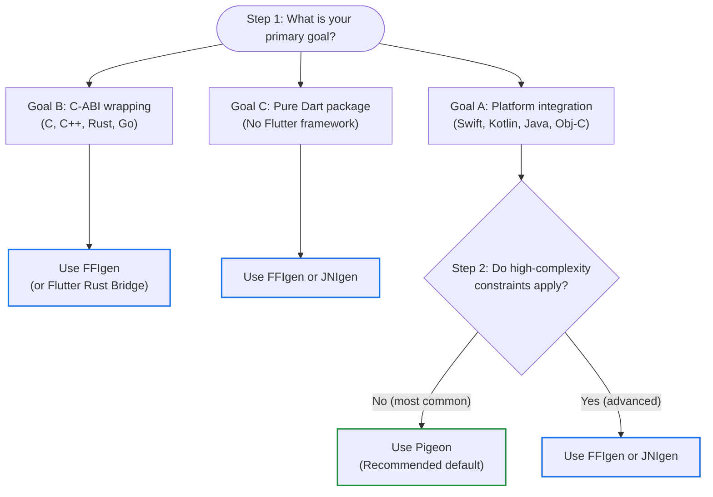

Flutter apps run on multiple platforms,
but sometimes you need to communicate directly with the host operating system
or call code from an existing native library.

To support these use cases, Flutter and Dart provide interop tools
that range from high-level, type-safe code generators to low-level FFI bindings.

Use the following decision tree to choose your interop solution,
or read on to learn how to package and structure native interop code.

## Choose your interop solution

### Step 1: Determine your primary goal

Identify which of the following goals matches your project:

- **Goal A: Platform integration.**
  Communicate with native operating system APIs
  (Swift, Kotlin, Java, or Objective-C) or expose a plugin API surface.
  Proceed to [Step 2: Evaluate Pigeon for Flutter plugins](#step-2-evaluate-pigeon-for-flutter-plugins).
- **Goal B: C-ABI wrapping.**
  Wrap an existing native library written in C, C++ (with `extern "C"`),
  Rust, or Go.
  **Recommendation:** Use [FFIgen](/platform-integration/interop/ffigen)
  (or [Flutter Rust Bridge][frb] for Rust).
- **Goal C: Pure Dart package.**
  Build a standalone Dart CLI tool or backend package without Flutter framework
  dependencies.
  **Recommendation:** Use [FFIgen](/platform-integration/interop/ffigen) or
  [JNIgen](/platform-integration/interop/jnigen).

### Step 2: Evaluate Pigeon for Flutter plugins

If you're building a Flutter plugin or calling host platform APIs,
verify whether [Pigeon](/platform-integration/interop/pigeon) fits your
technical constraints before choosing low-level direct bindings.

:::important
Migrating a plugin between Pigeon and FFIgen or JNIgen requires rewriting your
integration.
With Pigeon, you define APIs in Dart, generate native interfaces,
and write glue code in native languages (Kotlin, Swift, or C++).
With FFIgen and JNIgen, you generate Dart bindings from native APIs
and write glue code in Dart.
Because the glue code lives in different languages and architectural layers,
choose your interop tool carefully based on your project's constraints.
:::

Check whether any of the following advanced requirements apply to your feature:

- Passing large volumes of raw data using native pointers
  (for example, custom video frame buffers).
- Advanced cross-language object bridging
  (such as cross-language subclasses, delegates, or proxies).
- Manual memory management and custom multithreading instead of automated
  guardrails.
- Calling C, C++, Rust, or Go libraries directly.

Based on those requirements, choose one of the following paths:

- **No (most common): Use [Pigeon](/platform-integration/interop/pigeon).**
  Pigeon is the recommended default path for Flutter plugins.
  It provides type-safe contracts, handles memory lifetimes and data conversion,
  and calls Swift and Kotlin directly through FFI and JNI on Android, iOS,
  and macOS.
- **Yes: Use [FFIgen](/platform-integration/interop/ffigen) or
  [JNIgen](/platform-integration/interop/jnigen).**
  Direct interop generators give you full control over large native API surfaces
  and raw memory.

:::note
Using FFIgen and JNIgen directly requires managing
[threading][jnigen-threading] and [native memory lifetimes][objc-gc] yourself.
Pigeon is recommended for most plugins because it handles these concerns
automatically.
:::

## Package your interop code

Depending on how you plan to organize and share your code,
choose the packaging option that fits your use case.
To learn about the difference between a Dart package and a Flutter plugin,
refer to [Using packages](/packages-and-plugins/using-packages).

- **[In-app integration](/platform-integration/platform-channels).**
  Write native interop code directly inside your Flutter app without creating
  a separate package.
- **[Plugin package](/packages-and-plugins/developing-packages#plugin).**
  Create a specialized package that exposes platform-specific functionality
  (such as camera or sensor APIs) to Flutter apps
  (`flutter create --template=plugin`).
- **[FFI package](/packages-and-plugins/developing-packages#ffi).**
  Create a package that compiles and bundles native C or C++ code using
  [Dart build hooks][dart-hooks] and [`dart:ffi`](/platform-integration/interop/dart-ffi),
  and includes an [FFIgen](/platform-integration/interop/ffigen) configuration
  to regenerate Dart bindings (`flutter create --template=package_ffi`).

:::note
If you're bundling pre-compiled binaries (such as `.so` files on Android
or `.dylib` files on iOS and macOS), use `CodeAsset` in your `hook/build.dart`
script to bundle them into your package.
For details, refer to
[Bind to native code using FFI](/platform-integration/interop/bind-native-code#closed-source-libraries).
:::

To learn about authoring packages,
consult [Developing packages and plugins](/packages-and-plugins/developing-packages).

## Tool comparison

The following table compares direct interop generators (FFIgen and JNIgen)
and Pigeon across target languages:

| Target language | Direct interop | Pigeon |
| --- | --- | --- |
| **C** | [FFIgen](/platform-integration/interop/ffigen) | Not recommended (supported with platform channels, but not maintained by the Flutter team) |
| **C++ with `extern "C"`** | [FFIgen](/platform-integration/interop/ffigen) | Not recommended (refer to C) |
| **C++ without `extern "C"`** | Not supported | Supported on Windows with platform channels |
| **Rust with `extern "C"`** | [FFIgen](/platform-integration/interop/ffigen) | Not recommended (refer to C) |
| **Rust without `extern "C"`** | [Flutter Rust Bridge][frb] | Not supported |
| **Go with `extern "C"`** | [FFIgen](/platform-integration/interop/ffigen) | Not recommended (refer to C) |
| **Go without `extern "C"`** | Not supported | Not supported |
| **Java** | [JNIgen](/platform-integration/interop/jnigen) | Supported through Kotlin |
| **Kotlin** | [JNIgen](/platform-integration/interop/jnigen) | Supported (recommended) |
| **Objective-C** | [FFIgen](/platform-integration/interop/ffigen) | Supported through Swift |
| **Swift with `@objc` annotations** | [FFIgen](/platform-integration/interop/ffigen) | Supported (recommended) |
| **Swift without `@objc` annotations** | [`package:swiftgen`][swiftgen-pub] (experimental) | Supported (recommended) |

{:.table .table-striped}

- **Direct interop:** Generates low-level bindings directly against native
  headers or classes; requires manual memory and threading management.
- **Pigeon:** Generates structured, type-safe API contracts between Dart and the
  host platform; recommended default for Flutter plugins.

## Understand interop layers

Dart structures native interop into three architectural layers:
low-level bindings, idiomatic Dart APIs, and framework-specific plugins.
For complete architectural details,
consult the [native interop layers guide][interop-layers].

### Layer 1: Low-level bindings

Layer 1 consists of thin, unopinionated wrappers around native APIs
(such as [`dart:ffi`](/platform-integration/interop/dart-ffi),
`dart:js_interop`, [FFIgen](/platform-integration/interop/ffigen),
and [JNIgen](/platform-integration/interop/jnigen)).
These bindings mirror native signatures closely,
but require you to manage memory and threading manually.

### Layer 2: Idiomatic Dart APIs

Layer 2 wraps the low-level bindings in idiomatic Dart APIs to hide
platform-specific details (for example, [Pigeon](/platform-integration/interop/pigeon)
or [`package:sqlite3`][sqlite3-pub]).
This layer manages concurrency, memory lifetimes, and data conversions
automatically.

### Layer 3: Framework-specific plugins

Layer 3 integrates with framework-specific lifecycle and UI APIs
(such as the Flutter Plugin API).
This layer exposes clean Dart APIs to your Flutter app while encapsulating
platform objects like Android's `Context` or iOS's application lifecycle.

[frb]: {{site.pub-pkg}}/flutter_rust_bridge
[swiftgen-pub]: {{site.pub-pkg}}/swiftgen
[sqlite3-pub]: {{site.pub-pkg}}/sqlite3
[dart-hooks]: {{site.dart-site}}/tools/hooks
[jnigen-threading]: https://github.com/dart-lang/native/blob/main/pkgs/jnigen/doc/threading.md
[objc-gc]: https://github.com/dart-lang/native/blob/main/pkgs/ffigen/doc/objc_gc.md
[interop-layers]: https://github.com/dart-lang/native/blob/main/doc/interop-layers.md
