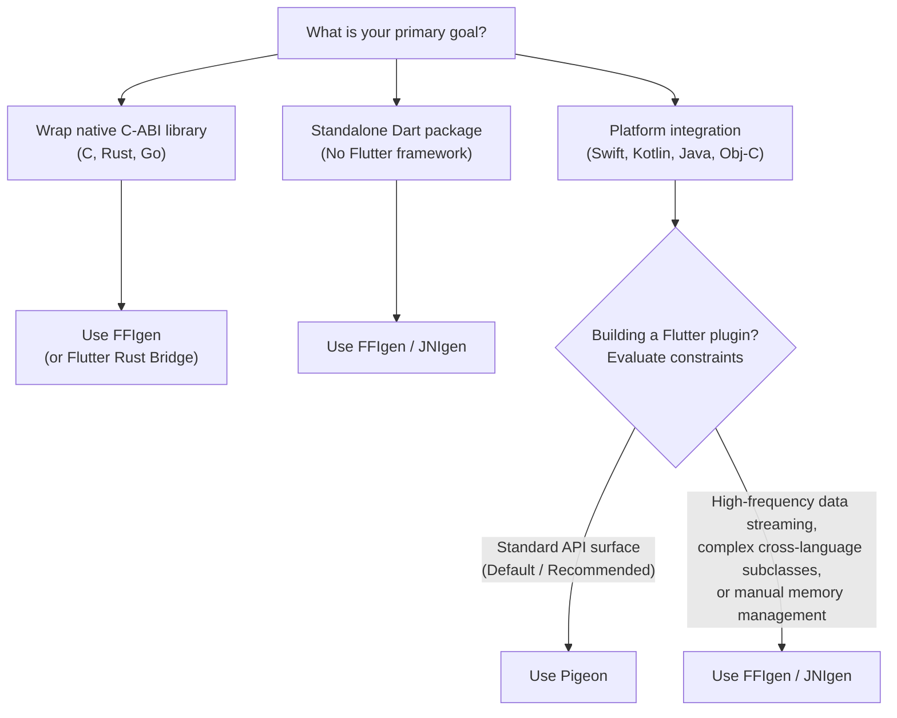

Flutter apps run on multiple platforms,
but sometimes you need to communicate directly
with the host operating system or run code from an existing native library.

To solve this, Flutter provides several interop tools ranging from
code generators to direct FFI bindings.

Use the following decision tree to choose your interop solution,
or learn more about the native interop layers.

## Choose your interop solution

### Step 1: Determine your primary goal

* **Goal A: Platform integration**
  Communicate with native OS features (Swift, Kotlin, Java, Objective-C)
  or expose an API surface.
  ➡ (Proceed to Step 2)
* **Goal B: C-ABI wrapping**
  Wrap an existing native library (C, Rust, Go).
  👉 Use [FFIgen](/platform-integration/interop/ffigen)
  (or Flutter Rust Bridge for Rust).
* **Goal C: Pure Dart package**
  Build a Dart CLI tool without Flutter framework dependencies.
  👉 Use [FFIgen](/platform-integration/interop/ffigen) or
  [JNIgen](/platform-integration/interop/jnigen).

### Step 2: Evaluate Pigeon for Flutter plugins

If you are building a Flutter plugin,
first verify whether Pigeon satisfies your technical constraints.

:::important
Migrating a plugin between Pigeon and FFIgen/JNIgen is non-trivial.
Choose your interop solution carefully based on your initial project constraints.
With Pigeon, you define APIs in Dart, generate native interfaces, and write
glue code in native languages (Kotlin, Swift, C++).
With FFIgen/JNIgen, you generate Dart APIs from native code and write glue code
in Dart.
Because glue code lives in completely different languages and architectural
layers, switching approaches requires rewriting the integration.
:::

Do any of the following requirements apply to your feature?

* Your app processes high-frequency raw data (e.g., video processing).
* Your integration requires advanced language bridging
  (e.g., cross-language subclasses, delegates, or proxies).
* Your feature requires manual memory management and multithreading over
  guardrails.
* Your target language is C, C++, Rust, or Go.

**NO (Most common)** 👉 **USE [PIGEON](/platform-integration/interop/pigeon).**
This is the default, recommended path.
It provides necessary guardrails, creates easily digestible interface mappings,
and is highly efficient for most API surface areas.

**YES** 👉 **USE [FFIgen](/platform-integration/interop/ffigen) /
[JNIgen](/platform-integration/interop/jnigen).**
You need the flexibility, complexity, and performance of direct interop for
larger surface areas.

:::note
Directly using FFIgen and JNIgen introduces potential pitfalls,
particularly around threading and memory management.
Pigeon is generally recommended because it has fewer potential pitfalls
and provides safer guardrails.
:::

## Packaging your interop code

Depending on how you plan to share your code,
choose the option that best suits your use case.

:::note
To learn about the difference between a package and a plugin,
refer to [Using packages](/packages-and-plugins/using-packages).
:::

* **In-app integration**
  Write your native interop code directly inside your Flutter app without
  creating a separate package.
* **Plugin**
  A specialized package that makes native platform functionality (such as a
  device's camera or sensors) available to your app
  (`flutter create --template=plugin`).
  To learn more, refer to
  [Developing plugin packages](/packages-and-plugins/developing-packages#plugin).
* **FFI package**
  A package that compiles and bundles native C/C++ code using Dart build hooks
  and `dart:ffi`.
  This method also includes an `ffigen.yaml` configuration file to regenerate
  Dart bindings (`flutter create --template=package_ffi`).
  To learn more, refer to
  [Developing FFI packages](/packages-and-plugins/developing-packages#ffi).

:::note
If you're using pre-compiled binaries (such as `.so` files on Android or
`.dylib` files on iOS), use `CodeAsset` in your `hook/build.dart` script to
bundle them into your package.
:::

For more details on package authoring,
refer to [Developing packages & plugins](/packages-and-plugins/developing-packages).

## Tool comparison

| Target language | Direct interop | Pigeon |
|---|---|---|
| **C** | [FFIgen](/platform-integration/interop/ffigen) | Not recommended. Supported with platform channels, but not maintained by the Flutter team. |
| **C++ with `extern "C"`** | [FFIgen](/platform-integration/interop/ffigen) | (Refer to C) |
| **C++ without `extern "C"`** | FFIgen (not yet supported) | Supported with platform channels, but not maintained by the Flutter team. |
| **Rust with `extern "C"`** | [FFIgen](/platform-integration/interop/ffigen) | (Refer to C) |
| **Rust without `extern "C"`** | Flutter Rust Bridge | Not supported |
| **Go with `extern "C"`** | [FFIgen](/platform-integration/interop/ffigen) | (Refer to C) |
| **Go without `extern "C"`** | Not supported | Not supported |
| **Java** | [JNIgen](/platform-integration/interop/jnigen) | Supported via Kotlin |
| **Kotlin** | [JNIgen](/platform-integration/interop/jnigen) | Supported |
| **Objective-C** | [FFIgen](/platform-integration/interop/ffigen) | Supported via Swift |
| **Swift without Obj-C compatibility annotations** | Swiftgen (experimental) | Supported |

* Direct interop: Lower-level direct bindings, higher performance for large data,
  requires manual memory and threading management.
* Pigeon: Structured type-safe code generator, recommended default for plugins.

## Understanding interop layers

Dart structures native interop into three distinct layers:
low-level bindings, idiomatic Dart APIs, and framework-specific plugins.

For complete architectural details,
consult the [native interop layers guide](https://github.com/dart-lang/native/blob/main/doc/interop-layers.md).

### Layer 1: Low-level bindings

Layer 1 consists of thin, high-performance, and unopinionated wrappers around
native code (for example, `dart:ffi`, `dart:js_interop`, FFIgen, and JNIgen).
These APIs mirror native signatures closely but require manual memory and
threading management.

### Layer 2: Idiomatic Dart APIs

Layer 2 consists of idiomatic Dart APIs that wrap the low-level layer to hide
platform-specific complexities (for example, Pigeon or the `sqlite3` package).
These manage concurrency, memory lifetimes, and data conversions automatically.

### Layer 3: Framework-specific plugins

Layer 3 provides integration with framework-specific APIs (for example, the
Flutter Plugin API).
This layer exposes Dart APIs to the framework while hiding platform details
like Android's `Context` or iOS's application lifecycle.
